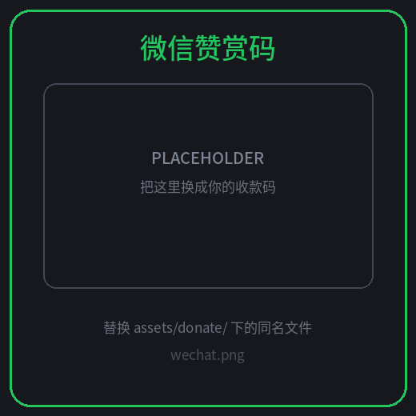

# Cloudflare Free Tier Usage Panel

> Tampermonkey userscript that shows how much of your Cloudflare free tier you have burned — as progress bars, right inside the dashboard.

[](https://github.com/ChaunceyXCX/cloudflare-free-usage-panel/stargazers)
[](https://github.com/ChaunceyXCX/cloudflare-free-usage-panel/releases)
[](LICENSE)
[](https://www.tampermonkey.net/)

中文 → [README.md](README.md)

An orange “CF” bubble sits in the bottom-right corner of `dash.cloudflare.com`. Click it and you get a usage board: 13 metrics, colour-coded progress bars, red pulsing bars once you pass the quota. **Zero configuration** by default (it reuses your dashboard session), or plug in a read-only API token instead. UI is available in **English / 简体中文**, switchable instantly.

<!-- Add a screenshot: save one as docs/preview.png and uncomment the line below -->
<!--  -->

---

## Contents

- [Features](#features)
- [Metrics and quotas](#metrics-and-quotas)
- [Install](#install)
- [Usage](#usage)
- [Where the data comes from](#where-the-data-comes-from)
- [Design notes](#design-notes)
- [Privacy](#privacy)
- [Known limitations](#known-limitations)
- [FAQ](#faq)
- [Development](#development)
- [Donate](#donate)

## Features

- **13 metrics as progress bars**: Workers / KV (reads, writes, storage) / D1 (rows read, rows written, storage) / R2 (Class A, Class B, storage) / Queues / Durable Objects / Workers AI.
- **Quota percentage at a glance**: < 70% green, ≥ 70% amber, ≥ 90% pulsing red. Over quota clamps the bar to 100% while the number stays honest (e.g. 104%).
- **Zero-config start**: session mode reuses your dashboard login and sends only **2 merged GraphQL requests** per refresh.
- **Token mode fallback**: paste a read-only token (`Account Analytics : Read`) when you want maximum reliability.
- **Draggable**: move the bubble and the panel anywhere; positions persist and can be reset from Settings.
- **Bilingual UI**: `Follow browser / 简体中文 / English`, applied instantly.
- **Never blanks out on failure**: if a refresh fails, the previous data stays on screen and the meta line notes “showing last data”.
- **Diagnostics pane**: version, mode, request count, collected metrics and failed jobs — one-click copy.
- **Shadow DOM isolation**: no style bleed either way; duplicate refreshes within 2 s are debounced.

## Metrics and quotas

| Section | Metric | Free quota | Reset |
|---|---|---|---|
| Daily | Workers requests | 100k / day | 00:00 UTC |
| Daily | KV reads | 100k / day | 00:00 UTC |
| Daily | KV writes + deletes + lists | 1k / day | 00:00 UTC |
| Daily | D1 rows read | 5M / day | 00:00 UTC |
| Daily | D1 rows written | 100k / day | 00:00 UTC |
| Daily | Durable Objects requests | 100k / day | 00:00 UTC |
| Daily | Queues operations | 10k / day | 00:00 UTC |
| Daily | Workers AI neurons | 10k / day | 00:00 UTC |
| Monthly | R2 Class A operations | 1M / month | 1st, 00:00 UTC |
| Monthly | R2 Class B operations | 10M / month | 1st, 00:00 UTC |
| Storage | KV storage | 1 GB | peak |
| Storage | D1 storage (account total) | 5 GB | peak |
| Storage | R2 storage | 10 GB-month | peak |

Quotas come from the Free Tier Summary at <https://www.cloudflare.com/plans>. If Cloudflare changes them, edit `LIMITS` at the top of the script.

## Install

1. Install [Tampermonkey](https://www.tampermonkey.net/) (Violentmonkey works too).
2. Create a new script, paste all of [`cf-free-usage-panel.user.js`](cf-free-usage-panel.user.js), hit `Ctrl + S`.
3. Open <https://dash.cloudflare.com> and click the orange “CF” bubble (or press `Alt + U`).

You can also copy the latest version straight from the [Releases](https://github.com/ChaunceyXCX/cloudflare-free-usage-panel/releases) page.

## Usage

| Action | Effect |
|---|---|
| `Alt + U` / click the bubble | Toggle the panel |
| Drag the bubble | Move it anywhere, position is remembered |
| Drag the panel header | Move the panel (header buttons still work) |
| Hover / click a metric row | Show “used / quota / remaining” |
| Settings → Reset position | Back to the default bottom-right spot |
| Settings → Language | Follow browser / 简体中文 / English |
| Settings → Refresh interval | 1 / 2 / 5 / 10 / 15 / 30 min (no requests while collapsed) |

### Switching to Token mode (optional)

Use it when session mode keeps hitting sporadic 403s:

1. Avatar → **My Profile** → **API Tokens** → **Create Token** → **Custom token**;
2. Permission: `Account` → `Account Analytics` → `Read`, scope it to your account;
3. Copy the token, paste it into Settings → **API Token** → **Save & refresh**.

The token lives only in local userscript storage and is only ever sent to `api.cloudflare.com`.

## Where the data comes from

The panel queries the **GraphQL Analytics API** (account-level datasets) that powers the dashboard charts. No HTML scraping, no screenshots, no third-party server.

| Mode | Transport | Notes |
|---|---|---|
| **Session mode** (default) | same-origin `POST /api/v4/graphql` with dashboard cookies + `XSRF-TOKEN` → `X-CSRF-Token` | Zero config; 2 merged requests per refresh; sporadic 403s are dashboard bot protection |
| **Token mode** | `GM_xmlhttpRequest` → `api.cloudflare.com/client/v4/graphql` with a Bearer token | Immune to dashboard CSRF/bot checks; needs a read-only token once |

The script deliberately **does not** try to bypass Cloudflare's CSRF/bot protection: session mode stays on same-origin `fetch`, retries a 403 once with a short backoff, and otherwise stops immediately.

## Design notes

- **Two requests per refresh**: the 10 datasets are grouped by filter type and merged into 2 documents via GraphQL `alias`; each alias is evaluated on its own, so a single broken dataset only greys out its own rows.
- **Automatic degradation**: if a field does not exist in your account's schema, the whole merged document fails — the script then falls back to per-job queries and remembers the working variant, so the next refresh is back to 2 requests.
- **403 handling**: one 700 ms backoff retry, then treat as throttled — stop the round and keep the previous data.
- **Error classification**: only 401 / token errors count as auth failures; 403 is treated as throttling and gets a different message.
- **Local snapshot**: results are cached in userscript storage so reopening the panel is instant.

## Privacy

- No backend, no telemetry, no analytics. Requests only go to `dash.cloudflare.com` (session mode) or `api.cloudflare.com` (token mode).
- Read-only: the script never calls write endpoints and never changes account settings.
- Only `XSRF-TOKEN` is read (for the request header); no other cookies are touched and no credentials are uploaded.
- The API token is stored locally (`cfu.token`) and never leaves your machine except toward `api.cloudflare.com`.

## Known limitations

- **Storage metrics are "recent peak"**: KV/D1 use a 2-day `max`, R2 uses a 24-hour `max(payloadSize + metadataSize)`. The dashboard bills GB-month averages, so numbers can differ slightly (marked with `*`).
- **R2 Class A/B is inferred locally** from `actionType` (`Put/List/Copy/Delete/Create/Upload` → A, `Get/Head` → B), marked with `*`.
- **Not covered**: Pages builds, Images transformations, Vectorize dimensions, Hyperdrive queries — no stable account-level GraphQL dataset for them yet.
- **Session mode** depends on the dashboard session and can hit sporadic 403s; switch to Token mode if that persists.

## FAQ

**Everything is grey / “n/a”?** Hit Refresh once. If it stays grey, open Settings → Diagnostics: a 403 is dashboard bot protection, and Token mode is the reliable fix.

**Numbers don't match the billing page.** Billing uses settlement rules (GB-month averages, 64 KB chunked queue operations); this panel reads analytics datasets, i.e. real-time approximations meant for trends and early warning, not for invoicing.

**Does it slow the dashboard down?** It refreshes every 5 minutes by default, sends nothing while collapsed, and each round is exactly 2 requests.

**Token mode and page CSP?** `GM_xmlhttpRequest` bypasses page CSP for the API call; in session mode the script automatically falls back to a single extension request if `fetch` is blocked.

## Development

```bash
npm install          # jsdom, only needed for tests
npm run lint         # node --check
npm test             # collection-layer unit tests (stubbed fetch, 84+ assertions)
npm run test:dom     # jsdom UI smoke test (render / drag / i18n / 403 / snapshot protection)
npm run test:all     # everything
```

`__CFU__` is exposed in the page console with `JOBS / GROUPS / LIMITS / buildCtx / collect / gql / t / setLang`.

```
cf-free-usage-panel.user.js   # the userscript (single file, no deps)
test.mjs                      # collection tests
test-dom.mjs                  # UI smoke tests
assets/donate/                # donation QR codes
```

## Donate

If this saved you some time, you can buy me a coffee ☕ Totally optional — every feature works without it.

[](https://www.paypal.com/ncp/payment/3EL6CKZ57Y8NE)
[](https://ChaunceyXCX.github.io/cloudflare-free-usage-panel/docs/donate.html)

| WeChat Pay | Alipay |
|:---:|:---:|
|  |  |

- **PayPal (cards accepted, no account needed)**: <https://www.paypal.com/ncp/payment/3EL6CKZ57Y8NE>
- **Donation page (WeChat / Alipay / PayPal button)**: <https://ChaunceyXCX.github.io/cloudflare-free-usage-panel/docs/donate.html>
- Even easier: leave a **Star** ⭐ or open an issue. That counts just as much.

> ⚠️ Both QR images are **placeholders** — see [`assets/donate/README.md`](assets/donate/README.md), drop your own codes in as `wechat.png` / `alipay.png`.

> 💡 GitHub strips `<script>` from READMEs, so the PayPal Hosted Button can't live there — it is embedded in [`docs/donate.html`](docs/donate.html) on GitHub Pages.

## License

[MIT](LICENSE) © chauncey

---

If it helped, please leave a ⭐ [Star](https://github.com/ChaunceyXCX/cloudflare-free-usage-panel) .
