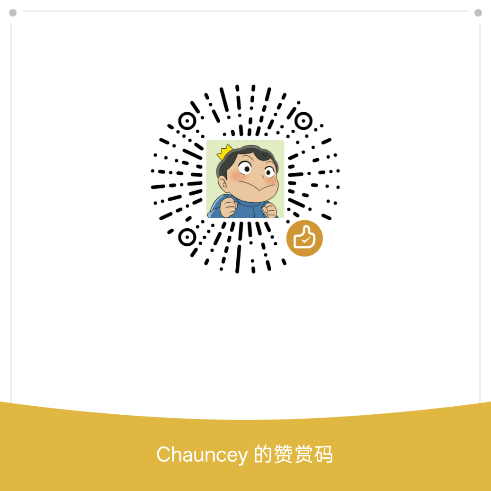

# Cloudflare 免费额度用量面板

> Tampermonkey 脚本：在 Cloudflare 控制台里用进度条一眼看清免费账号各项资源的用量

[](https://github.com/ChaunceyXCX/cloudflare-free-usage-panel/stargazers)
[](https://github.com/ChaunceyXCX/cloudflare-free-usage-panel/releases)
[](LICENSE)
[](https://www.tampermonkey.net/)

English → [README.en.md](README.en.md)

在 `dash.cloudflare.com` 右下角挂一个橙色「CF」悬浮球，点开就是一张用量看板：13 项指标、进度条分档配色、超额度红色呼吸。**零配置**（复用控制台登录），也可以换成只读 API Token。界面支持**中文 / English** 即时切换。

<!-- 想放截图：把面板截图存成 docs/preview.png，然后取消下面这行注释 -->
<!--  -->

---

## 目录

- [功能](#功能)
- [监控的指标与免费额度](#监控的指标与免费额度)
- [安装](#安装)
- [使用](#使用)
- [数据来源](#数据来源)
- [设计要点](#设计要点)
- [隐私](#隐私)
- [已知限制](#已知限制)
- [常见问题](#常见问题)
- [开发与测试](#开发与测试)
- [打赏](#打赏)

## 功能

- **13 项指标、进度条直观化**：Workers / KV（读、写、存储）/ D1（读、写、存储）/ R2（Class A、Class B、存储）/ Queues / Durable Objects / Workers AI。
- **免费额度自动换算百分比**：< 70% 绿色、≥ 70% 琥珀色、≥ 90% 红色呼吸闪烁；超额度时进度条裁到 100%，数字照实显示（如 104%）。
- **零配置起步**：默认复用控制台登录态（会话模式），每轮只发 **2 个**合并后的 GraphQL 请求。
- **Token 模式兜底**：需要绝对稳定时，粘一个只读令牌（`Account Analytics : Read`）走官方 API。
- **悬浮球与面板都能拖动**，位置持久化，可从设置里复位。
- **中英双语**：设置里 `跟随浏览器 / 简体中文 / English`，切换即时生效。
- **一个都不准也不清空面板**：刷新失败时保留上次数据，只在元信息里标注「刷新失败，展示上次数据」。
- **诊断区**：版本、模式、请求数、成功指标、失败任务一目了然，可一键复制。
- **Shadow DOM + 拖拽**：样式与控制台完全隔离，2 秒内重复刷新会被防抖丢弃。

## 监控的指标与免费额度

| 分区 | 指标 | 免费额度 | 重置 |
|---|---|---|---|
| 每日 | Workers 请求 | 100k / 天 | UTC 00:00 |
| 每日 | KV 读取 | 100k / 天 | UTC 00:00 |
| 每日 | KV 写入 + 删除 + 列表 | 1k / 天 | UTC 00:00 |
| 每日 | D1 行读取 | 5M / 天 | UTC 00:00 |
| 每日 | D1 行写入 | 100k / 天 | UTC 00:00 |
| 每日 | Durable Objects 请求 | 100k / 天 | UTC 00:00 |
| 每日 | Queues 操作 | 10k / 天 | UTC 00:00 |
| 每日 | Workers AI Neurons | 10k / 天 | UTC 00:00 |
| 每月 | R2 Class A 操作 | 1M / 月 | 每月 1 日 UTC 00:00 |
| 每月 | R2 Class B 操作 | 10M / 月 | 每月 1 日 UTC 00:00 |
| 存储 | KV 存储 | 1 GB | 按峰值 |
| 存储 | D1 存储（账号总量） | 5 GB | 按峰值 |
| 存储 | R2 存储 | 10 GB-month | 按峰值 |

额度数值取自 <https://www.cloudflare.com/plans> 的 Free Tier Summary。官方调整后改脚本顶部 `LIMITS` 即可。

## 安装

1. 安装 [Tampermonkey](https://www.tampermonkey.net/)（Violentmonkey 亦可）。
2. 新建脚本，把 [`cf-free-usage-panel.user.js`](cf-free-usage-panel.user.js) 全文粘进去，`Ctrl + S` 保存。
3. 打开 <https://dash.cloudflare.com>，点右下角橙色「CF」（或按 `Alt + U`）。

也可以直接从 [Releases](https://github.com/ChaunceyXCX/cloudflare-free-usage-panel/releases) 页面复制最新版本。

## 使用

| 操作 | 说明 |
|---|---|
| `Alt + U` / 点悬浮球 | 展开 / 收起面板 |
| 拖动悬浮球 | 任意移动，松手记住位置 |
| 拖动标题栏 | 移动面板（标题栏上的按钮不受影响） |
| 悬停 / 点击进度条行 | 显示「已用 / 额度 / 剩余」明细 |
| 设置 → 重置位置 | 回到默认右下角 |
| 设置 → 界面语言 | 跟随浏览器 / 简体中文 / English |
| 设置 → 自动刷新间隔 | 1 / 2 / 5 / 10 / 15 / 30 分钟（面板收起时不发请求） |

### 切换到 Token 模式（可选）

会话模式偶发 403 时用它：

1. 控制台右上角头像 → **My Profile** → **API Tokens** → **Create Token** → **Custom token**；
2. 权限只勾 `Account` → `Account Analytics` → `Read`，账户范围选你的账号；
3. 复制令牌，粘进面板「设置 → API Token」→ **保存并刷新**。

令牌只存在本机油猴存储中，脚本只用它请求 `api.cloudflare.com`。

## 数据来源

面板读的是控制台图表背后的 **GraphQL Analytics API**（账号级 dataset），不抓 HTML、不截图、不经过任何第三方服务器。

| 模式 | 走法 | 特点 |
|---|---|---|
| **会话模式**（默认） | 同源 `POST /api/v4/graphql`，复用控制台 Cookie + `XSRF-TOKEN` → `X-CSRF-Token` | 零配置；每轮仅 2 个合并请求；偶发 403 属控制台风控 |
| **Token 模式** | `GM_xmlhttpRequest` → `api.cloudflare.com/client/v4/graphql`，Bearer 认证 | 不受 CSRF/风控影响；需要手动建一次只读令牌 |

脚本**不会**绕过 Cloudflare 的 CSRF / 风控策略：会话模式只走同源 `fetch`，被 403 就退避重试一次，仍失败则本轮立即收敛。

## 设计要点

- **每轮只 2 个请求**：10 个 dataset 按过滤器类型分组，用 GraphQL `alias` 合并成 2 个文档，逐个 alias 判定成败 —— 单块失败只影响自己那几行。
- **合并失败自动降级**：某个字段在你账号的 schema 上不存在会让整文档校验失败，此时自动退化为逐项查询，并把坏变体记住（下一轮合并直接用对的那个），请求数随即回到 2。
- **403 处理**：只做一次 700ms 退避重试；仍失败即判定被风控，立刻停止本轮剩余请求，并保留上次成功的数据。
- **严格区分错误类型**：只有 401 / 令牌类错误算鉴权失败，403 按「节流/风控」处理，两者提示文案不同。
- **本地快照**：结果写入油猴存储，重开页面秒开上次数据，并标注更新时间。

## 隐私

- 没有后端、没有遥测、没有统计上报；所有请求只发往 `dash.cloudflare.com`（会话模式）或 `api.cloudflare.com`（Token 模式）。
- 只执行 **读取** 操作，不会调用任何写接口，不改你的账号设置。
- 脚本只读取 `XSRF-TOKEN` 用于请求头；不读取其它 Cookie，也不上传任何凭证。
- API Token 仅存于 Tampermonkey 本地存储（`cfu.token`），不会出现在日志或网络请求之外的地方。

## 已知限制

- **存储类指标是「近期峰值」**：KV / D1 取近 2 天 `max`，R2 取近 24 小时 `max(payloadSize + metadataSize)`，与控制台按平均值展示的 GB-month 口径略有差异（会带 `*` 标记）。
- **R2 Class A/B 是本地归类**：按 `actionType` 推断（`Put/List/Copy/Delete/Create/Upload` → A，`Get/Head` → B），带 `*` 标记。
- **未覆盖**：Pages 构建次数、Images 转换次数、Vectorize 维度、Hyperdrive 查询数等目前没有稳定的账号级 GraphQL dataset，未纳入面板。
- **会话模式**依赖控制台登录态，偶发 403；持续失败请改用 Token 模式。

## 常见问题

**Q：打开就一片灰 / 显示「未取到」？**
先点一次「刷新」。仍是灰色就看设置里的诊断区：403 属控制台风控，切 Token 模式即可稳定。

**Q：数字和控制台账单页对不上？**
账单页按结算口径（如 GB-month 平均、按 64KB 分块计费的 Queues 操作）统计，本面板直读 analytics dataset，属于「实时近似值」，用于看趋势和预警，不作为账单凭证。

**Q：会拖慢控制台吗？**
默认 5 分钟刷新一次，面板收起时完全不发请求；每轮固定 2 个请求。

**Q：Chrome 提示「扩展正在调试」/ 控制台报 CSP？**
Token 模式用 `GM_xmlhttpRequest` 直连官方 API，不触发页面 CSP；会话模式若被 CSP 拦，会自动退到同样一次扩展请求。

## 开发与测试

```bash
npm install          # 仅为跑测试装 jsdom
npm run lint         # node --check 语法检查
npm test             # 采集层单测（打桩 fetch，84+ 断言）
npm run test:dom     # jsdom UI 冒烟测试（渲染 / 拖拽 / i18n / 403 / 快照保护）
npm run test:all     # 全量
```

浏览器控制台里 `__CFU__` 暴露了 `JOBS / GROUPS / LIMITS / buildCtx / collect / gql / t / setLang` 等调试接口。

目录结构：

```
cf-free-usage-panel.user.js   # 脚本本体（单文件，无依赖）
test.mjs                      # 采集层单测
test-dom.mjs                  # UI 冒烟测试
assets/donate/                # 打赏二维码
```

## 打赏

如果这个脚本帮你省了时间，可以请我喝杯咖啡 ☕ 完全自愿，不打赏也照常全功能使用。

[](https://www.paypal.com/ncp/payment/3EL6CKZ57Y8NE)
[](https://ChaunceyXCX.github.io/cloudflare-free-usage-panel/donate.html)

| 微信 | 支付宝 |
|:---:|:---:|
|  |  |

- **PayPal（支持信用卡，无需账号）**：<https://www.paypal.com/ncp/payment/3EL6CKZ57Y8NE>
- **打赏页（含微信 / 支付宝 / PayPal 按钮）**：<https://ChaunceyXCX.github.io/cloudflare-free-usage-panel/donate.html>
- 更省事的方式：点个 **Star** ⭐ 或提个 Issue，对我来说同等重要。

> ⚠️ 目录里的两张二维码目前是**占位图**，替换方法见 [`assets/donate/README.md`](assets/donate/README.md)：把自己的收款码存成同名的 `wechat.png` / `alipay.png` 覆盖即可。

> 💡 GitHub 的 README 会过滤 `<script>`，所以 PayPal 托管按钮（Hosted Buttons）不能直接嵌在 README 里 —— 它被放在 GitHub Pages 的 [`docs/donate.html`](docs/donate.html) 打赏页上。

## 许可

[MIT](LICENSE) © chauncey

---

如果它帮到了你，顺手点个 ⭐ [Star](https://github.com/ChaunceyXCX/cloudflare-free-usage-panel) 呗。
